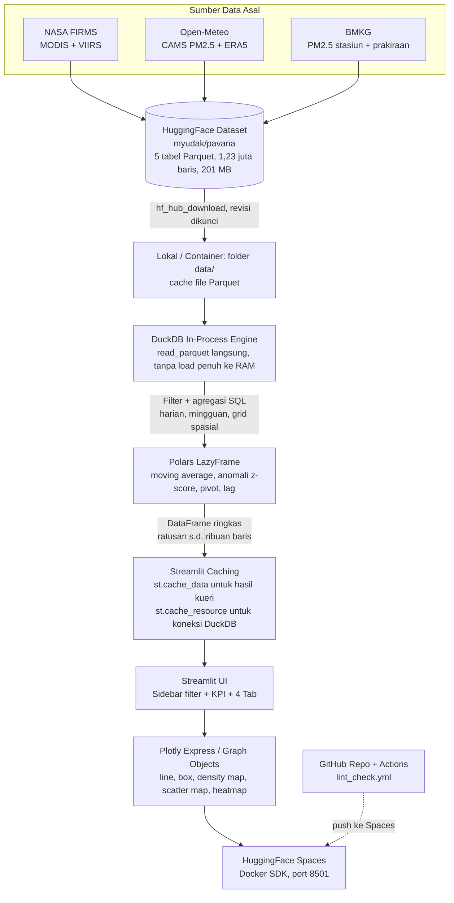

# Dokumen Arsitektur & Pitch Proposal Produk Data (Phase 1)

**Mata Kuliah:** Analisis Big Data
**Target Check-in:** Pertemuan 10 (Diumumkan Pertemuan 8, repositori dibagikan Pertemuan 9)
**Nama Tim:** Mukhamad Sofyan & Mohammad Ravlindo Saputra
**Topik / Judul Produk Data:** **Pavana Dashboard — Pemantauan Titik Panas dan Kualitas Udara (PM2.5) Kalimantan 2024–2026**

---

## 1. Problem Statement & Sasaran Pengguna (The Pitch)

### 1.1 Latar Belakang Masalah

Kalimantan hampir setiap tahun mengalami kebakaran hutan dan lahan (karhutla), terutama saat musim kemarau dan fenomena El Niño. Asap dari kebakaran menurunkan kualitas udara (PM2.5 tinggi), mengganggu kesehatan dan transportasi, dan sering melintasi batas wilayah. Data pendukungnya tersebar di banyak sumber dengan format, zona waktu, dan cakupan ruang yang berbeda: deteksi satelit NASA FIRMS, model kualitas udara CAMS, reanalisis cuaca ERA5, serta observasi dan prakiraan BMKG.

Dataset gabungannya (`myudak/pavana`) berisi **±1,23 juta baris**, dengan **1,16 juta di antaranya deteksi titik panas**. Data sebesar itu sulit dieksplorasi lewat spreadsheet atau notebook statis. Dashboard interaktif dibutuhkan agar pengguna dapat menyaring wilayah, periode, dan sensor, lalu langsung melihat pola musiman, lonjakan titik panas, dan hubungannya dengan PM2.5 serta kondisi angin dan hujan.

### 1.2 Target Pengguna (Target Audience)

- Analis atau peneliti lingkungan dan meteorologi (misalnya BMKG, KLHK, universitas) yang butuh eksplorasi cepat pola karhutla.
- BPBD dan pemangku kebijakan daerah di Kalimantan untuk memantau periode dan area rawan.
- Mahasiswa dan peneliti data sebagai contoh *data product* di atas data besar.
- Masyarakat umum yang ingin memahami kondisi udara dan titik panas di sekitarnya.

### 1.3 Nilai Tambah & Wawasan Utama

Setelah menggunakan dashboard, pengguna dapat:

1. Mengetahui **kapan** (bulan/minggu) dan **di mana** (sebaran koordinat, kepadatan titik) aktivitas titik panas memuncak.
2. Membandingkan **tahun ke tahun** (2024, 2025, 2026) dan mengenali musim puncak.
3. Melihat hubungan **eksploratif** antara lonjakan titik panas dan PM2.5 CAMS di Kubu Raya, ditambah angin, hujan, dan kelembapan dari ERA5.
4. Menemukan **anomali** (hari dengan PM2.5 atau jumlah titik panas jauh di atas normal).
5. Mengecek **kondisi PM2.5 observasi stasiun BMKG** dan prakiraan cuaca terbaru sebagai pembanding singkat.

> **Catatan batasan (wajib ditampilkan di dashboard):** titik panas adalah *deteksi satelit*, bukan kebakaran terkonfirmasi. PM2.5 CAMS adalah *keluaran model*, bukan observasi. Hubungan titik panas dan PM2.5 hanya bersifat eksploratif, bukan klaim sebab-akibat.

---

## 2. Sumber Dataset & Skala Data

| Parameter | Keterangan |
|-----------|------------|
| **Nama Dataset** | Pavana — Titik Panas & Kualitas Udara Kalimantan (2024–2026) |
| **Sumber Resmi** | https://huggingface.co/datasets/myudak/pavana (data asal: NASA FIRMS, Open-Meteo/CAMS/ERA5, BMKG) |
| **Format Awal** | Parquet (kelima tabel utama), plus CSV mentah FIRMS dan JSON mentah BMKG |
| **Ukuran Data** | **1.230.444 baris**, ±201 MB (Parquet terkompresi). Tabel utama `hotspots` = **1.156.755 baris** (memenuhi syarat >1 juta baris) |
| **Dimensi Waktu / Temporal** | 2024-01-01 s.d. 2026-10-14. `cams` dan `weather` per jam (24.432 baris); `hotspots` per kejadian akuisisi satelit; `bmkg_pm25` 21 jam; `bmkg_weather` prakiraan 2 hari |
| **Zona Waktu** | Semua kanonik **UTC**. Dashboard menampilkan opsi konversi ke WIB (UTC+7) |
| **Cakupan Ruang** | `hotspots`: bbox Kalimantan (lat −4,37…4,50; lon 108,0…119,5). `cams`/`weather`: **satu sel grid** di Kubu Raya. `bmkg_pm25`: 9 stasiun. `bmkg_weather`: 12 wilayah adm4 |

**Inventaris tabel (konfigurasi) yang dipakai:**

| Tabel | File Parquet | Baris | Peran di dashboard |
|-------|--------------|------:|--------------------|
| `hotspots` | `processed/hotspot_kalimantan.parquet` | 1.156.755 | **Tabel utama:** tren, peta, kepadatan, distribusi FRP |
| `cams` | `raw/open_meteo/cams_kubu_raya_sungai_raya_2024-01-01_2026-10-14.parquet` | 24.432 | PM2.5/PM10 model, konteks kualitas udara |
| `weather` | `raw/open_meteo/weather_kubu_raya_sungai_raya_2024-01-01_2026-10-14.parquet` | 24.432 | Suhu, RH, hujan, angin, tekanan (ERA5) |
| `bmkg_pm25` | `pm25/pm25_observasi_kalimantan.parquet` | 189 | Observasi stasiun (snapshot pembanding) |
| `bmkg_weather` | `prakiraan/prakiraan_cuaca_kalimantan.parquet` | 204 | Prakiraan cuaca BMKG (snapshot) |

**Fitur / Kolom Kunci:**

- `hotspots`: `lat`, `lon`, `acquired_at`, `acq_date`, `instrument`/`satellite`, `frp_mw`, `daynight`, `confidence_pct` (MODIS), `confidence_class` (VIIRS), `processing`, `source_sensor`.
- `cams`: `valid_at`, `pm25_ug_m3`, `pm10_ug_m3`.
- `weather`: `valid_at`, `temperature_c`, `rh_pct`, `precip_mm`, `wind_speed_ms`, `wind_dir_from_deg`, `boundary_layer_height_m` (4.368 jam kosong).
- `bmkg_pm25`: `stasiun`, `lat`, `lon`, `valid_at_utc`, `pm25_ug_m3`, `kondisi_terkini`.
- `bmkg_weather`: `kotkab`, `desa`, `valid_at_utc`, `suhu_c`, `hujan_mm`, `angin_ms`, `cuaca`.

**Keterbatasan data yang dijaga oleh desain (sesuai dataset card):**

| Keterbatasan | Dampak pada desain |
|--------------|--------------------|
| `cams` dan `weather` hanya 1 sel grid (Kubu Raya) | Label eksplisit "Titik Kubu Raya"; **tidak** di-join ke tiap titik panas dan tidak digeneralisasi ke seluruh Kalimantan |
| Baris `SP` dan `NRT` pada `hotspots` bisa memuat deteksi yang sama | Hitungan memakai kolom `processing`, dengan `SP` diprioritaskan; jangan menjumlahkan mentah dari batch |
| Dua skala keyakinan (`confidence_pct` MODIS vs `confidence_class` VIIRS) | Tidak digabung; filter keyakinan dibuat terpisah per sensor |
| Nilai kosong dibiarkan `null`, tidak diisi `0` | Metrik memakai agregasi yang mengabaikan `null`; ada indikator "data kosong" pada grafik |
| `bmkg_pm25` hanya 21 jam, `bmkg_weather` hanya snapshot | Ditampilkan sebagai panel pembanding "snapshot terbaru", bukan untuk validasi |
| `cams` bukan observasi | Seluruh grafik PM2.5 CAMS diberi label "Model CAMS" |

---

## 3. Diagram Arsitektur Data & Aliran Informasi



**Ringkasan alur:**

1. **Ingest:** saat startup, skrip mengunduh 5 file Parquet dari HuggingFace Dataset dengan `hf_hub_download` (revisi dikunci pada commit hash agar reproducible) ke folder `data/`.
2. **Query:** DuckDB membaca Parquet langsung dari disk (`read_parquet`) dan menjalankan filter serta agregasi berat. Dataset mentah 1,16 juta baris tidak pernah dimuat utuh ke memori Streamlit.
3. **Transform:** hasil agregasi dikirim ke Polars untuk fitur turunan (rata-rata bergerak, z-score anomali, pivot musiman).
4. **Cache:** hasil ringkas disimpan lewat `@st.cache_data` dengan kunci berupa parameter filter.
5. **Visualisasi:** Streamlit menampilkan KPI, filter, dan grafik Plotly interaktif.
6. **Deploy:** Docker image dijalankan di HuggingFace Spaces (staging di Phase 3, production di Final Release).

---

## 4. Rencana Pemrosesan Data & Strategi Caching

### 4.1 Peran DuckDB (SQL Engine)

- **Cara baca:** `read_parquet('data/hotspot_kalimantan.parquet')` langsung. DuckDB hanya membaca kolom dan *row group* yang dibutuhkan (*projection and predicate pushdown*).
- **Operasi berat yang didelegasikan ke DuckDB:**
  - Agregasi jumlah titik panas per hari, minggu, dan bulan, per sensor, per `daynight`.
  - Agregasi spasial: pembulatan koordinat ke grid 0,25° untuk peta kepadatan (`GROUP BY ROUND(lat/0.25), ROUND(lon/0.25)`).
  - Statistik FRP (median, persentil 95) dan distribusi per bulan.
  - Window function: *running total* kumulatif titik panas per tahun, perbandingan year-over-year.
  - Join **temporal harian** antara agregat titik panas Kalimantan dan rata-rata harian PM2.5 CAMS Kubu Raya (hasil sudah ringkas).
  - `SUMMARIZE` untuk profil kualitas data (null, min, maks) yang ditampilkan di tab Info Data.

Contoh kueri inti (`src/queries.py`):

```sql
-- Tren harian titik panas dengan filter dinamis
SELECT CAST(acq_date AS DATE) AS tanggal,
       instrument,
       COUNT(*)              AS n_hotspot,
       AVG(frp_mw)           AS frp_rata2
FROM v_hotspot_clean   -- view hasil dedup SP/NRT dari read_parquet('data/hotspot_kalimantan.parquet') (lihat 4.3)
WHERE acq_date BETWEEN ? AND ?
  AND instrument IN (SELECT UNNEST(?))
GROUP BY 1, 2
ORDER BY 1;

-- Running total per tahun (window function)
SELECT tanggal,
       SUM(n_hotspot) OVER (PARTITION BY year(tanggal) ORDER BY tanggal) AS kumulatif_tahun
FROM harian;
```

### 4.2 Peran Polars (Transformasi Data)

Polars (`LazyFrame`) menerima hasil ringkas dari DuckDB (bentuk Arrow, tanpa salin penuh) dan menjalankan:

- **Rata-rata bergerak** 7 dan 30 hari untuk jumlah titik panas dan PM2.5.
- **Deteksi anomali:** z-score harian terhadap rata-rata bergerak, dengan tanda `anomali = |z| > 3`.
- **Pivot musiman:** matriks bulan × tahun (heatmap).
- **Fitur lag eksploratif:** korelasi PM2.5 CAMS dengan titik panas pada lag 0–3 hari (ditampilkan sebagai korelasi, bukan prediksi).
- **Konversi zona waktu** UTC → WIB untuk tampilan.
- **Penanganan null:** `null` tetap `null` (tidak diisi 0) sesuai dataset card.

### 4.3 Strategi Optimasi Memori & Caching Streamlit

| Masalah | Strategi |
|---------|----------|
| Reload lambat saat filter berubah | `@st.cache_data(ttl=3600)` pada setiap fungsi kueri; kunci cache = parameter filter (rentang tanggal, sensor, wilayah) |
| Koneksi DuckDB dibuat berulang | `@st.cache_resource` untuk satu koneksi DuckDB per proses (read-only) |
| 1,16 juta baris tidak boleh masuk session state | `session_state` hanya menyimpan nilai filter, **bukan** DataFrame mentah; semua DataFrame yang dikembalikan ke UI sudah teragregasi |
| Peta dengan jutaan titik terlalu berat | Peta kepadatan memakai **agregat grid**; mode titik individual dibatasi (misal ≤ 20.000 titik, sampel/top FRP) dan hanya aktif setelah filter menyempit |
| Duplikasi SP vs NRT | Satu *view* DuckDB `v_hotspot_clean` yang menghapus duplikat (prioritas `SP`) dan dipakai semua kueri |
| Pra-komputasi | Skrip `src/prepare.py` membuat tabel agregat kecil (`harian.parquet`, `grid_bulanan.parquet`) saat build image, sehingga kueri interaktif hanya menyentuh file ringan |
| Batas RAM HuggingFace Spaces (CPU gratis, ±16 GB) | Target penggunaan < 2 GB berkat DuckDB out-of-core dan agregat; ukuran seluruh dataset hanya ±201 MB |
| Startup lama | Download Parquet dilakukan sekali saat build/first run dan di-*cache* di `data/`; file yang sudah ada dilewati |

---

## 5. Rencana Tampilan Dashboard (Wireframe & Fitur UI)

```
+----------------------------------------------------------------------------+
|  PAVANA — Titik Panas & Kualitas Udara Kalimantan 2024–2026                |
|  [KPI 1: Total Titik Panas] [KPI 2: Hari Puncak] [KPI 3: PM2.5 Maks] [KPI 4: Tren] |
+-------------+--------------------------------------------------------------+
| SIDEBAR     | [Tab 1 Tren] [Tab 2 Distribusi & Anomali] [Tab 3 Peta]       |
| Rentang     | [Tab 4 Kualitas Udara & Cuaca] [Tab 5 Tabel & Info Data]     |
| tanggal     |                                                              |
| Sensor      |   (area grafik Plotly interaktif)                            |
| Confidence  |                                                              |
| Siang/Malam |                                                              |
| Zona waktu  |                                                              |
+-------------+--------------------------------------------------------------+
```

1. **Header & Key Metrics KPI (4 kartu):**
   - Total titik panas pada periode terfilter (dengan delta vs periode sebelumnya).
   - Hari dengan titik panas terbanyak (rekor ekstrem).
   - PM2.5 CAMS maksimum dan rata-rata (Kubu Raya) pada periode.
   - Tren persentase vs periode setara tahun sebelumnya.
2. **Filter Interaktif (Sidebar):**
   - Slider/date picker rentang tanggal.
   - Multiselect sensor (MODIS, VIIRS SNPP/NOAA-20/NOAA-21).
   - Filter keyakinan (slider `confidence_pct` untuk MODIS, pilihan `l/n/h` untuk VIIRS, terpisah).
   - Filter siang/malam (`daynight`), granularitas waktu (harian/mingguan/bulanan), toggle UTC/WIB.
3. **Panel Visualisasi Utama:**
   - **Tab 1 — Tren Temporal:** line chart jumlah titik panas dengan range slider + rata-rata bergerak 7/30 hari; kurva kumulatif per tahun (perbandingan 2024/2025/2026).
   - **Tab 2 — Distribusi & Anomali:** box plot FRP per bulan/sensor; histogram FRP; penanda hari anomali (z-score) pada tren.
   - **Tab 3 — Peta Spasial:** peta kepadatan (density mapbox / grid heatmap) titik panas Kalimantan dengan animasi per bulan; opsi scatter titik individual setelah filter menyempit; overlay 9 stasiun BMKG.
   - **Tab 4 — Kualitas Udara & Cuaca (Kubu Raya):** PM2.5/PM10 CAMS per jam/harian vs titik panas harian (dual axis); wind rose dari `wind_dir_from_deg`/`wind_speed_ms`; heatmap korelasi lag; panel snapshot PM2.5 stasiun BMKG dan prakiraan cuaca 2 hari.
   - **Tab 5 — Tabel Data & Info Data:** cuplikan data terfilter (maks ±1.000 baris) dengan tombol **Download CSV ringkasan**; tabel `SUMMARIZE`; panel keterbatasan data dan atribusi sumber (NASA FIRMS, Open-Meteo, CAMS/ECMWF, BMKG).

---

## 6. Pembagian Tugas & Tanggung Jawab Anggota Tim

Tim terdiri dari **2 anggota**, sehingga peran frontend dibagi bersama.

| Anggota Tim | Tanggung Jawab Utama Phase 1–4 |
|-------------|--------------------------------|
| **Mohammad Ravlindo Saputra** (Lead Architect / Data Pipeline & Backend) | Desain arsitektur dan `docs/architecture.md`; skrip unduh dan cache dataset (`hf_hub_download`); `src/prepare.py` (agregat); kueri DuckDB di `src/queries.py` (dedup SP/NRT, agregasi grid, window function); `Dockerfile` dan `requirements.txt`; lint GitHub Actions |
| **Mukhamad Sofyan** (Frontend Streamlit / Visualisasi) | Transformasi Polars (rata-rata bergerak, anomali, pivot, lag); `app.py` (layout, sidebar, KPI, tab); grafik Plotly dan peta; strategi `st.cache_data`; deployment HuggingFace Spaces (staging dan production); video demo |
| **Bersama** | Pengujian interaktivitas dan performa, penulisan `README.md`, AI Disclosure Statement, persiapan presentasi |

### Risiko dan Mitigasi

| Risiko | Mitigasi |
|--------|----------|
| Peta lambat karena jutaan titik | Agregasi grid sebagai default, batas jumlah titik individual |
| Salah tafsir (korelasi dianggap sebab-akibat; CAMS dianggap observasi) | Label dan catatan batasan permanen di UI |
| Dataset di HuggingFace berubah | Kunci revisi/commit hash dan verifikasi `manifest.json` |
| Cold start Spaces lambat | Pra-unduh data dan agregat saat build Docker |
| Batch `NRT` terbaru tidak reproducible | Dokumentasikan bahwa angka beberapa hari terakhir dapat berubah |